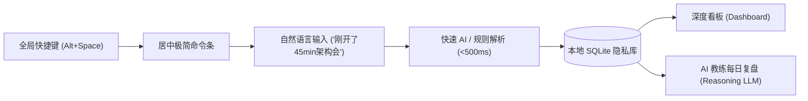
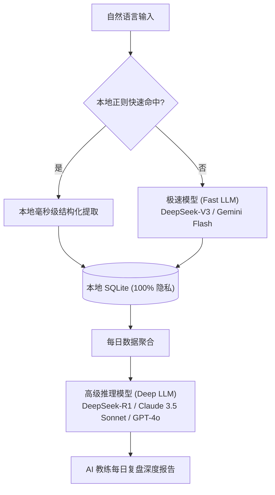

# ChronosFlow（时流）：AI 驱动的 PC 极简时间管理应用设计白皮书

> 极简输入・无感记录・深度洞察・100% 隐私安全

---

## 1. 产品定位与愿景

传统 PC 时间管理软件往往陷入两难困境：
- **被动监控类**（如 RescueTime）：虽然省心，但大量杂乱无章的应用进程记录缺乏**主观意图**，无法区分“真学习”还是“假工作”；
- **主动打卡类**（如各类番茄钟、Toggl）：功能繁琐，每次切换任务都要经历多次点击、填表，给大脑增加巨大认知负担，极易中途放弃。

**ChronosFlow 的核心主张**：
以 **“Raycast 般的无摩擦随手记”** 配合 **“大模型语义理解与私人教练式深度复盘”**。用户在 PC 工作间隙，只需一个全局快捷键，用一句大白话记录当前或过去的事情，剩余的结构化、归类、时间对齐以及每日深度洞察，全部交由 AI 自动化完成。

---

## 2. 核心交互与形态架构

应用采用 **多窗口协同形态**，常驻后台，内存控制在 30~50MB 以内。

### 2.1 居中极简命令条（Command Bar）
- **触发机制**：全局快捷键（默认 `Alt + Space` 或 `Win + Shift + T`）。
- **视觉风格**：仿 Raycast / Spotlight 居中浮窗，亚克力/毛玻璃高质感边框，无标题栏。
- **即时反馈**：输入框下方实时提示解析出的时间段、标签与状态，回车后毫秒级隐入后台并伴随轻微微动效或提示。

### 2.2 深度看板窗口（Dashboard）
- **触发机制**：系统托盘右键打开、快捷指令或命令条输入 `open` / `stats`。
- **视觉风格**：Linear / Notion 极简暗色/浅色自适应风格。
- **核心模块**：
  1. **今日时间流（Interactive Timeline）**：流式时间块展示，支持一键微调或拖拽修正。
  2. **精力与分类看板（Analytics）**：深度工作时长、任务切换损耗指数、项目耗时占比。
  3. **AI 教练复盘专栏（AI Coach Debrief）**：每日/每周生成的深度洞察报告、精力低谷预警及针对性调整建议。
  4. **系统设置（Settings）**：模型 API Key 配置、本地 Ollama 切换、快捷键自定义。

### 2.3 系统托盘（System Tray）
- 图标随当前状态动态变化（空闲状态 / 正在专注计时）。
- 鼠标悬停显示：“当前专注：[React组件重构] 已用时 28 分钟”。

---

## 3. 自适应时态与语义模型

ChronosFlow 采用 **双模时态感知机制**，彻底解决时间记录的断层问题：

| 用户自然语言示例 | 判定时态 | 系统行为 |
| :--- | :--- | :--- |
| `开始复习英语单词` | **实时进行时 (Active)** | 启动当前任务会话，托盘进入计时状态，时间戳对齐当前时间。 |
| `刚改了半小时登录Bug，有点烦` | **事后追溯 (Retroactive)** | 计算 `[当前时间 - 30m, 当前时间]`，记录情绪标签为“受挫/阻滞”，直接归档已完成块。 |
| `完成了` / `收工` | **任务结算 (Finish)** | 结束当前正在进行的实时任务，记录实际消耗时长并触发微复盘。 |
| 超过 60 分钟无操作后呼出 | **断层填补提醒 (Smart Gap)** | 命令条上方浮现温和提示：*“14:30 至 15:45 有 1 小时 15 分钟空白，做了什么吗？”*，点击可一键补录。 |

---

## 4. 分级双擎 AI 架构与 100% 本地隐私

1. **快速解析引擎（Fast Tier）**：
   - 输入到反馈要求 `<500ms`。
   - 优先通过本地时间正则（如 `半小时`、`从2点到3点`）做零耗时解析；
   - 复杂语义调用极速 API（如 `deepseek-chat` / `gemini-1.5-flash` / `gpt-4o-mini` 或本地小模型）。
2. **深度推理引擎（Deep Tier）**：
   - 每日晚间或点击复盘时触发。
   - 调用强推理大模型（如 `deepseek-reasoner` / `claude-3-5-sonnet`），分析：
     - **上下文切换代价（Context-switching Cost）**；
     - **精力峰谷曲线与高价值产出匹配度**；
     - **情绪与拖延阻力识别**（从自然语言随手记的字里行间挖掘阻碍因素）；
     - **次日微习惯建议**。
3. **数据主权与隐私（Privacy First）**：
   - 所有原始时间流数据纯本地存储在 SQLite 数据库中；
   - 支持 OpenAI 兼容规范（支持 DeepSeek、OpenAI、Claude、Ollama 本地大模型）；
   - API Key 采用本地安全存储（Windows Credential Manager / 本地加密存储）。

---

## 5. 技术选型与项目结构

- **底层核心**：`Tauri v2` (Rust)
  - 极小体积（打包后约 15MB）与极致内存占用（30~50MB）
  - 插件支持：`tauri-plugin-global-shortcut`、`tauri-plugin-tray`、`tauri-plugin-sql`
- **前端架构**：`React 19` + `TypeScript` + `Vite`
- **UI 体系**：`Tailwind CSS` + `shadcn/ui` + `Lucide React` 图标
- **状态管理**：`Zustand`
- **本地数据库**：`SQLite`

---

## 6. MVP（V1.0）实施落地路线图

- [ ] **Phase 0：环境准备**
  - 安装 Rust/Cargo 编译工具链（通过 `winget` 或 `rustup`）
  - 验证 MSVC Build Tools 与 Tauri v2 CLI
- [ ] **Phase 1：工程脚手架与双窗口架构**
  - 初始化 `tauri-v2 + react-ts + vite` 项目
  - 实现透明无边框 Command Bar 窗口与 Dashboard 窗口管理
  - 注册全局快捷键与系统托盘菜单
- [ ] **Phase 2：本地数据库与数据模型**
  - 设计 SQLite 表结构（`activities`, `daily_summaries`, `settings`）
  - 实现 Rust/TypeScript 数据持久化与查询接口
- [ ] **Phase 3：输入解析与时态状态机**
  - 本地时间正则规则提取器
  - 快速 AI API（OpenAI 兼容协议）结构化集成
  - 实现“实时计时”与“事后追溯”双模状态流转
- [ ] **Phase 4：Dashboard 时间流看板与 AI 深度复盘**
  - 交互式今日时间轴组件
  - AI 每日复盘 Prompt 设计与长文本流式报告渲染
  - API Key 与自定义模型配置面板
